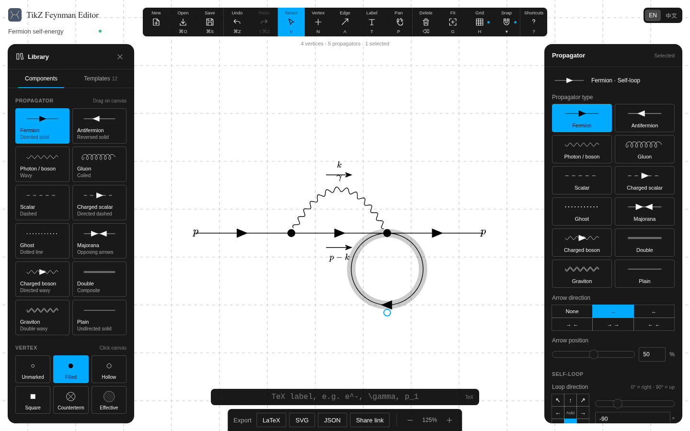

# TikZ Feynman Editor

This repository offers a visual interface for drawing Feynman diagrams, with export functionality for SVG or LaTeX code. It is inspired by [another of the same name](https://github.com/srossd/tikz-feynman-editor.git) as well as [quiver](https://github.com/varkor/quiver.git).



## How to Use

Use the [online editor](https://haixuan-lin.github.io/tikz-feynman-editor/) directly in your browser. GitHub Pages automatically tests, builds and publishes the web editor whenever changes are pushed to `main`.

On macOS (Apple Silicon), compile the repository into an application in this directory by running:

```bash
./build.sh
```

The script detects missing build tools and dependencies automatically. Native compilation, binary stripping and code signing explicitly use Apple tools, including Apple's `codesign_allocate`, so Conda tools with the same names on `PATH` cannot replace them. The native executable is checked as Mach-O before and after stripping.

After a successful build, install the app into `/Applications/` by running:

```bash
./install.sh
```

To use the browser version during development, run:

```bash
npm ci
npm run dev
```

Open `http://127.0.0.1:8000` in a browser. Web development requires `Node.js ≥ 22.12` and `npm`. Command `npm test` runs the tests; `npm run dist` produces a standalone web app.

## Native TikZ-Feynman appearance

New vertices and propagators inherit the package defaults. LaTeX export omits line width, vertex size, color, fill and pattern overrides until you explicitly customize them. Blob vertices retain the native hatch pattern. The inspector provides a **TikZ-Feynman default** option to restore inheritance; numeric hints are shown in pt for line width and mm for vertex size and momentum distance.

Older projects migrate the editor's former default sizes, widths and colors to inheritance. Other saved custom values are preserved. Saved projects record this distinction so an explicit custom value remains custom after reopening.

Select a propagator and click an SVG preview under **Propagator type** to change its type. Self-loops export as closed vector curves with native arrow and insertion styles, preserving their direction, radius and ellipse ratio.
